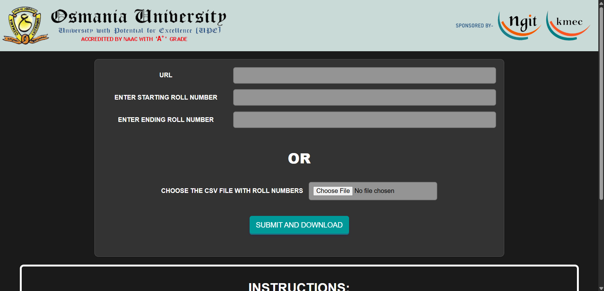

# OU Grade Retrieval Automation

## Introduction

OU Grade Retrieval Automation collects an Osmania University examination batch into one Excel workbook. Developed by Baba Gandhi Kandagatla in his first year of engineering, the project received a college letter of appreciation. The author reports use by multiple OU-affiliated colleges.

## Tech stack

Python, Flask, Requests and Beautiful Soup handle the web workflow. Python threads retrieve result pages, and pandas with openpyxl writes the workbook. A separate desktop version uses PyQt5.

## Features

- Collect results for a hall-ticket range or an uploaded list.
- Export subject grades and semester grade-point averages in a workbook organized by student.
- Include a missing-result entry when the parser recognizes an unavailable hall ticket.

## The process

1. Open the Flask form and enter the OU results page for the exam.
2. Enter an inclusive range of 12-digit hall-ticket numbers or upload a CSV or Excel file. For a file, include a header row and put the numbers in the first column.
3. The app divides the list among worker threads. Each worker requests individual result pages and extracts rows from their HTML tables with Beautiful Soup.
4. Download `results.xlsx`. It lists the roll number, subject code, subject name, grade points, grade secured and SGPA. The app adds a “not found” entry for hall tickets it recognizes as missing.

## How it can be improved

Saved, anonymized HTML fixtures would make it possible to test layout changes without contacting the university site. Useful cases include a missing hall ticket, a result with a withheld grade and a page with a reordered subject table.

## How to run

Use Python 3.9 in a virtual environment for compatibility with the pinned NumPy and pandas versions. From the repository root, run the following commands and open `http://127.0.0.1:5000`.

```sh
python -m pip install -r requirements.txt
python app.py
```

The Flask implementation is in `app.py`, with the collection form in `templates/index.html`. The repository also includes a desktop implementation in `trinetra.py`, which requires PyQt5 separately.

The parser expects the OU result URL pattern and table layout encoded in `app.py`. Changes to the university site can affect extraction. Use authorized hall-ticket lists and check a sample of exported grades against the source before relying on a batch result.

## Screenshots


